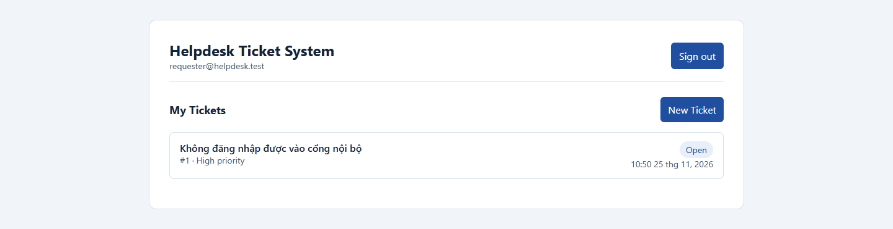
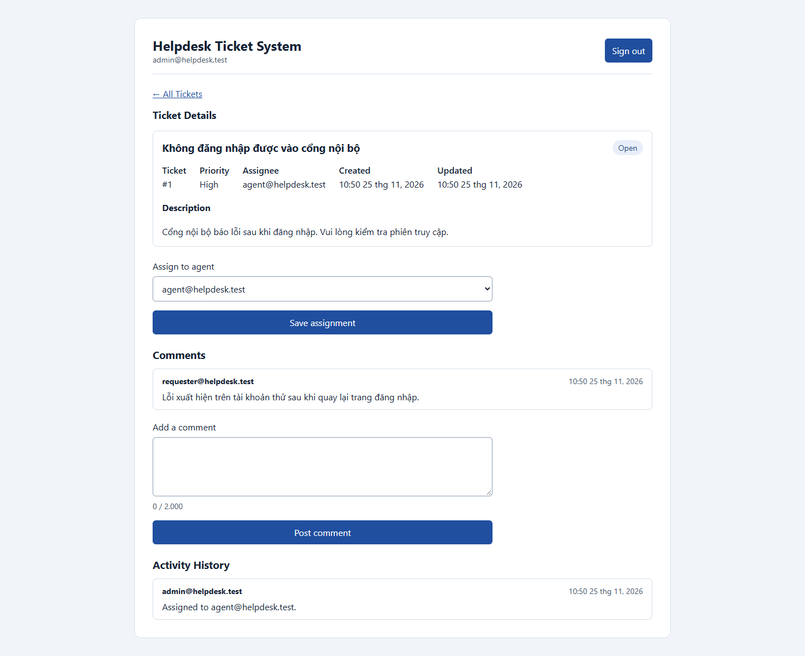
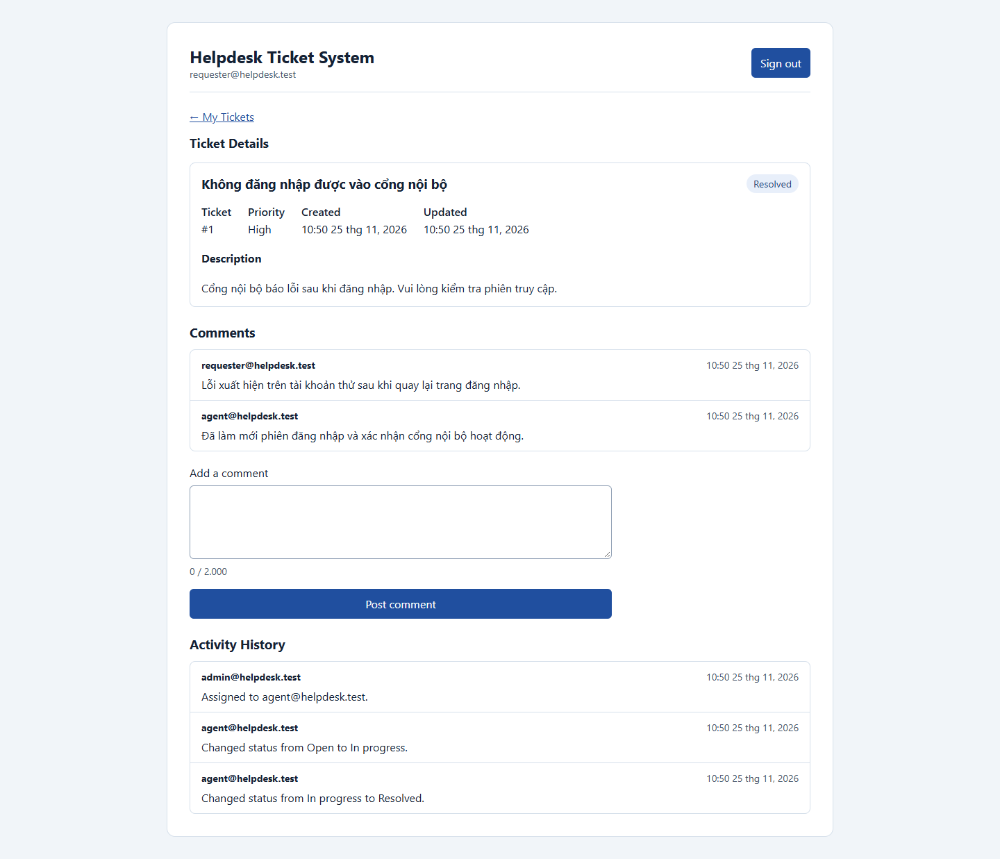

# Helpdesk Ticket System

## Giới thiệu

Helpdesk Ticket System là ứng dụng full-stack cá nhân để tiếp nhận và theo dõi yêu cầu hỗ trợ nội bộ. REQUESTER tạo ticket, ADMIN phân công và AGENT xử lý đến khi hoàn tất. Bình luận giữ trao đổi trong ticket, còn lịch sử ghi ai đã phân công hoặc chuyển trạng thái và thực hiện lúc nào.

## Tính năng theo vai trò

| Vai trò | Tính năng |
| --- | --- |
| REQUESTER | Tạo ticket, xem danh sách và chi tiết ticket của mình, bình luận và xem lịch sử xử lý. |
| ADMIN | Xem mọi ticket, lọc theo trạng thái hoặc người phụ trách, phân công hoặc đổi AGENT khi ticket còn `OPEN`, bình luận và xem lịch sử. |
| AGENT | Xem và bình luận trên ticket được giao. Chuyển ticket đang phụ trách theo thứ tự `OPEN → IN_PROGRESS → RESOLVED` và xem lịch sử. |

Ứng dụng dùng phiên đăng nhập và kiểm tra quyền ở backend. Khi hai người cùng sửa phân công hoặc trạng thái trên một phiên bản ticket, yêu cầu lỗi thời nhận thông báo xung đột và có thể tải lại dữ liệu.

## Ảnh minh họa



REQUESTER vừa tạo ticket “Không đăng nhập được vào cổng nội bộ” và thấy ticket mới trong **My Tickets**.



ADMIN đã giao chính ticket đó cho `agent@helpdesk.test`. Người phụ trách và thao tác phân công xuất hiện trên trang chi tiết.



REQUESTER mở lại ticket đã giải quyết và thấy bình luận xử lý, người thực hiện và thời điểm của từng sự kiện.

## Công nghệ sử dụng

- Backend (`backend/`) dùng Java 21, Spring Boot, Spring Web MVC, Spring Security, Spring Data JPA, Validation, Flyway và Maven Wrapper.
- Frontend (`frontend/`) dùng React, JavaScript, Vite và Oxlint.
- PostgreSQL 17 chạy bằng Docker Compose. Vite chuyển tiếp `/api` tới Spring Boot. Spring Security dùng cookie phiên và CSRF cho yêu cầu thay đổi dữ liệu.

## Hướng dẫn chạy trên máy

Cài **Git Bash** (Git for Windows), **JDK 21**, **Node.js 22.12 trở lên trong dòng 22.x** hoặc bản LTS mới hơn được hỗ trợ, và **Docker Desktop** có Docker Compose. Khởi động Docker Desktop. Kiểm tra `JAVA_HOME` và `java -version` cùng trỏ tới JDK 21 trong Git Bash. Sau khi clone, mở ba cửa sổ Git Bash tại thư mục gốc của repo.

### 1. PostgreSQL

```bash
[ -f .env ] || cp .env.example .env
docker compose --env-file .env up -d --wait postgres
docker compose ps
```

Cổng PostgreSQL mặc định là `5432`. Nếu cổng này đang được dùng, đặt `POSTGRES_PORT` thành một cổng trống trong `.env` trước khi chạy Compose và backend. PostgreSQL dùng các biến `POSTGRES_DB`, `POSTGRES_USER` và `POSTGRES_PASSWORD` để khởi tạo volume trống. Nếu dùng lại volume cũ, hãy dùng cấu hình khớp với cơ sở dữ liệu đã khởi tạo.

### 2. Backend

```bash
bash scripts/run-backend.sh
```

Script nạp `.env`, kiểm tra cổng backend (mặc định là `8080`) và chạy Maven Wrapper với múi giờ UTC. Flyway áp dụng migration khi Spring Boot khởi động. Khi cổng bận, script báo PID rồi thoát. Nếu script nhận diện một backend Helpdesk, chỉ dùng lại khi đó là phiên bản đang cần kiểm tra. Với phiên bản cũ, dừng chính tiến trình Helpdesk đó từ cửa sổ đã khởi động nó, rồi chạy lại script. Nếu cổng thuộc ứng dụng khác, chọn cách giải phóng cổng hoặc dùng cấu hình demo riêng và đặt đích Vite proxy tương ứng.

### 3. Frontend

```bash
cd frontend
npm ci
npm run dev
```

Mở `http://localhost:5173`. Trong một cửa sổ Git Bash khác, gọi trực tiếp backend và qua Vite để kiểm tra kết nối.

```bash
curl --fail http://localhost:8080/api/health
curl --fail http://localhost:5173/api/health
```

Cả hai lệnh trả `{"status":"UP","database":"UP"}` khi ứng dụng kết nối được với PostgreSQL. Nếu mở được ticket nhưng **Comments** và **Activity History** không tải, hãy kiểm tra cổng `8080` có đang chạy backend từ mã nguồn hiện tại hay không.

Nhấn Ctrl+C trong các cửa sổ chạy backend và frontend để dừng chúng. Từ thư mục gốc, dùng `docker compose --env-file .env down` để dừng PostgreSQL và giữ volume dữ liệu.

## Kịch bản demo

Đặt `HELPDESK_DEMO_ENABLED=true` trong `.env` trước khi khởi động backend. Nếu backend đang chạy, dừng nó và chạy lại `bash scripts/run-backend.sh`. Dùng cấu hình này với dữ liệu thử. Cả ba tài khoản dưới đây dùng mật khẩu demo `HelpdeskDemo!2026`.

| Vai trò | Email demo |
| --- | --- |
| REQUESTER | `requester@helpdesk.test` |
| ADMIN | `admin@helpdesk.test` |
| AGENT | `agent@helpdesk.test` |

1. Đăng nhập với **REQUESTER**, mở **My Tickets → New Ticket**, tạo ticket “Không đăng nhập được vào cổng nội bộ” với độ ưu tiên **High** và thêm bình luận mô tả lỗi. Ticket bắt đầu ở `OPEN`.
2. Chọn **Sign out** rồi đăng nhập với **ADMIN**. Trong **All Tickets**, mở ticket, chọn `agent@helpdesk.test` ở **Assign to agent** và nhấn **Save assignment**.
3. Đăng nhập với **AGENT**. Trong **Assigned Tickets**, mở ticket, chọn **Start work**, đăng bình luận ghi cách xử lý và chọn **Resolve ticket**.
4. Đăng nhập lại với **REQUESTER**, mở ticket và kiểm tra `RESOLVED`. Trong **Activity History**, đối chiếu một lần phân công và hai lần đổi trạng thái, cùng người thực hiện và thời điểm. Thử nhập bình luận chỉ có dấu cách để kiểm tra thông báo lỗi bình luận.

## Kiểm thử

Backend cần PostgreSQL đang chạy. Từ thư mục gốc, nạp cấu hình rồi chạy Maven Wrapper. Có thể dùng cơ sở dữ liệu thử riêng để tránh chạy kiểm thử trên dữ liệu đang dùng.

```bash
set -a
source <(sed 's/\r$//' .env)
set +a
export HELPDESK_DEMO_ENABLED=false
cd backend
bash ./mvnw -Duser.timezone=UTC verify
```

Trong một cửa sổ Git Bash khác, từ thư mục gốc chạy các lệnh kiểm tra frontend.

```bash
cd frontend
npm ci
npm run build
npm run lint
```
